------
#  Creditworthiness Predictive Modelling 

Machine Learning Classifiers for Creditworthiness Indicator.     
***Author***: Anh Dung Le  
***Date***: November 2026   
**License**: [CC BY 4.0](https://creativecommons.org/licenses/by/4.0/deed.en)   
@CodeAlpha internship

>**NOTE**: This document is for reporting and discussing modelling results. Instructions on how to run the notebooks yourself can be found in `how-to-run.md`.

##  1. Objective 

This is a hands-on project within the one-month **CodeAlpha** 2026 internship program in machine learning. The project aims to explore an available credit risk dataset and build a predictive model to determine the creditworthiness (Good/Bad) of customers based on it.  

**What is Creditworthiness?** Creditworthiness is an appraisal of a potential borrower's ability and willingness to repay debts by a lender such as a bank (see [Jim Akin (2023) - Experian](https://www.experian.com/blogs/ask-experian/what-is-creditworthiness/)). This can be determined from credit report and demographic information. 

**Why does this matter?** This indicator helps lenders (e.g., banks) make decisions and minimize the financial risks on bab debts. A creditworthy customer will find it easier and cheaper to access credit (and vice versa). 

##  2. Data 

### **Metadata**

The dataset used in this project is from [Kaggle](https://www.kaggle.com/datasets/alexdister/credit-risk-dataset). It is given in a CSV file. Some information is given below:

- Name: Credit Risk Dataset
- Owner: Alex Dister 
- License: [CC0: Public Domain](https://creativecommons.org/publicdomain/zero/1.0/)
- Last update: 2026
- Sources: This dataset was collected from a *simulated* Credit Risk Analytics project in the banking and financial sector, *inspired by real-world* credit assessment processes used by financial institutions such as Nova Bank.
 

### **Attributes**
- Number of entries: 32581
- Number of features (target exclusive): 28
- Target: `loan-status`

| No.| Feature | Description | Group |
|---|---|---|---|
| 1 | cliend_ID | client unique id number | Identifier
| 2 | person_age | age of borrower in years | Demographics
| 3 | gender | gender of borrower | Demographics
| 4 | marital_status | marital status of borrower | Demographics 
| 5 | education_level | highest education level attained | Demographics
| 6 | person_income | borrower's annual income (USD) | Demographics
| 7 | person_emp_length | employment length of the borrower | Demographics 
| 8 | employment_type | type of employment | Demographics
| 9 | person_home_ownership | house ownership status | Demographics
| 10 | country | country of residence | Demographics
| 11 | state | state/province of residence | Demographics
| 12 | city | city of residence | Demographics
| 13 | city_latitude | latitude coordinate of the city | Demographics
| 14 | city_longitude | longitude coordinate of the city | Demographics
| 15 | loan_amnt | requested loan amount in USD | Finance
| 16 | loan_intent | purpose of the loan | Finance
| 17 | loan_grade | redit grade assigned to the loan (A–G) | Finance
| 18 | loan_int_rate | loan interest rate applied (%) | Finance
| 19 | loan_term_months | term of the loan in months | Finance
| 20 | loan_percent_income | percentage of income allocated to loan payment | Finance
| 21 | loan_to_income_ratio | ratio of requested loan to total income | Finance
| 22 | other_debt | amount of other existing debts the borrower has | Finance
| 23 | debt_to_income_ratio | total debt to income ratio | Finance
| 24 | open_accounts | number of open credit accounts | Finance
| 25 | credit_utilization_ratio | credit utilization ratio | Finance
| 26 | cb_person_default_on_file | whether the borrower has defaulted previously (Y/N) | Finance
| 27 | cb_person_cred_hist_length | length of the borrower's credit history in years | Finance
| 28 | past_delinquencies | number of past loan delinquencies | Finance
| ***29*** | ***loan_status*** | ***loan repayment status (0 = non-default, 1 = default) $\to$ Creditworthiness Flag*** | ***Target***

##  3. Data analysis 

### **Basic observation**
- 29 Attributes:  float (9), int (8), str (12)
- There are abnormal data in the columns ``person_age`` and ``person_emp_length`` (> 100 years). A check reveals that these abnormal rows are small in size (few rows). So it is safe to remove theme.  
- No duplicates found
- Information on city's longitude and latitude can be (and should be) ignored. They just encode the city itself. (By the way, the city is usually not a useful information, as in this case.)  
- Name normalization:
    + `person_age` --> `person_age_years`
    + `person_income` --> `person_income_usd`
    + `person_emp_length` --> `person_emp_length_years`
    + `loan_amnt` --> `loan_amount_usd`
    + `other_debt` --> `other_debt_usd`
    + `cb_person_cred_hist_length` --> `cb_person_cred_hist_length_years`

### **Missing value analysis**
Two columns `loan_int_rate` and `person_emp_length_years` have missing values in their contents. The statistics of missing values is shown below:

| feature |  null_count  | null_pct (%) |
|--|--|--|  
|loan_int_rate | 3116| 9.563856|  
|  person_emp_length_years|         895|  2.747000|

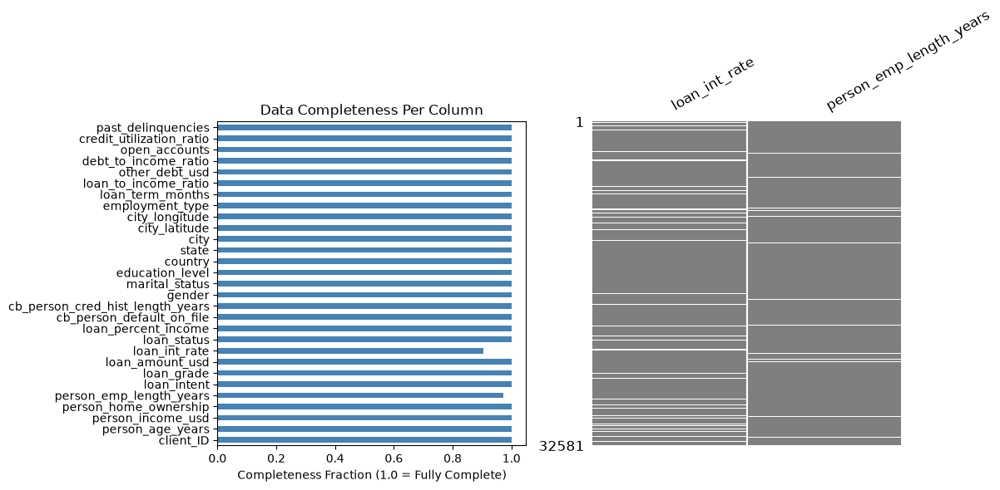

So, missing values take a small fraction of total content, but not negligible.

Univariate tests (Mann-Whittney U test for numerics and chi-squared test for categories), supplemented by Benjamini-Hochberg false discovery rate (fdr) correction, show that, with alpha level of 0.05,
- in the case of `loan_int_rate` one cannot reject H0 that assumes the same distributions/rates among null row and non-null rows -> the missingness pattern in `loan_int_rate` is not likely to associate with other observed variables. The null pattern is likely MCAR. 
- in the `person_emp_length_years`, one can reject H0 for some variables, such as `person_income_usd` or `other_debt_usd`. There are certain correlation here. The null pattern is likely MAR.

The size of missingness together with random patterns suggest that one might use kNN for imputation.

### **Target distribution**

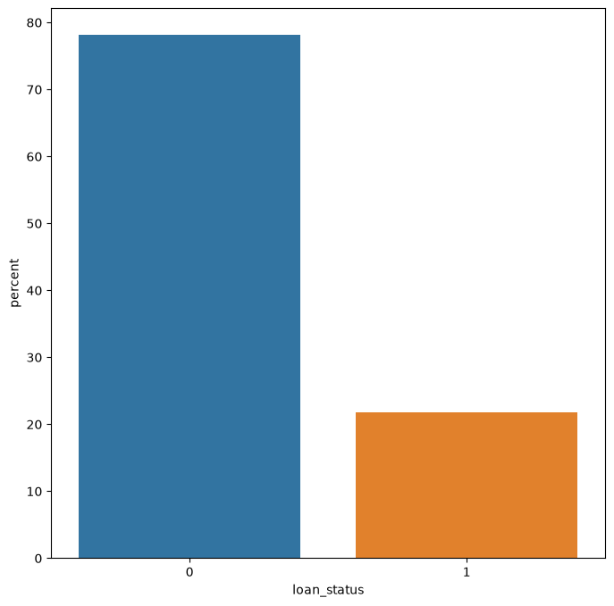

The default-to-non-default rate is about 1:3.58. So, this target is imbalanced. However, the class imbalance is mild.  

### **Target distribution by demographic features**

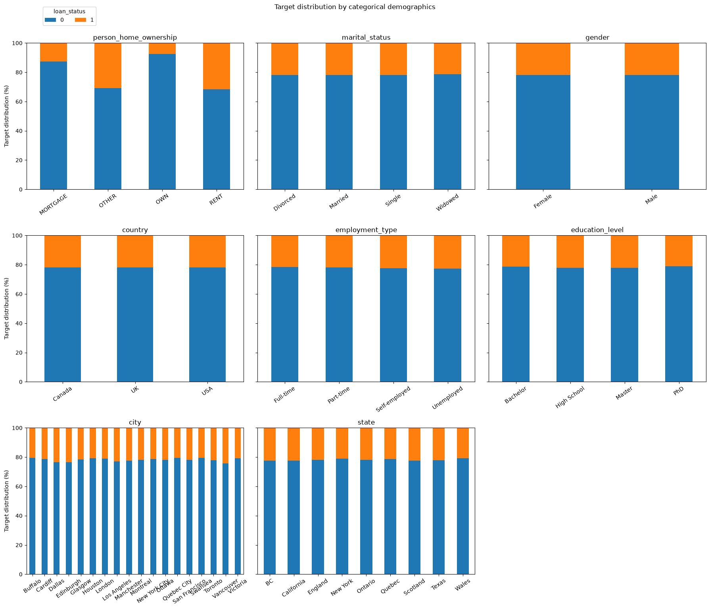
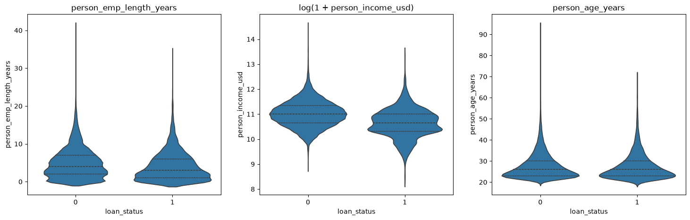

The distribution of the loan status is the (nearly) same for different categories in following demographic features: marital status, gender, country, employment type, education level. These features therefore would not help in modelling, better to remove.

The differences in target distribution among categories in city and state are small. These two features have rather high cardinality, so with OHE encoding, it would increase the feature space, make data look very sparse, and make the model training and inference slow. So, it would be harmful rather than helpful. Good idea to remove them.

Home ownership carries useful information related to the target: borrowers with owned house or mortgage are less likely to default. This feature is a useful predictor.

Income has a clear correlation with the loan status: non-default borrowers are likely to have higher income. This os also a good predictor.

### **Target distribution by financial features**

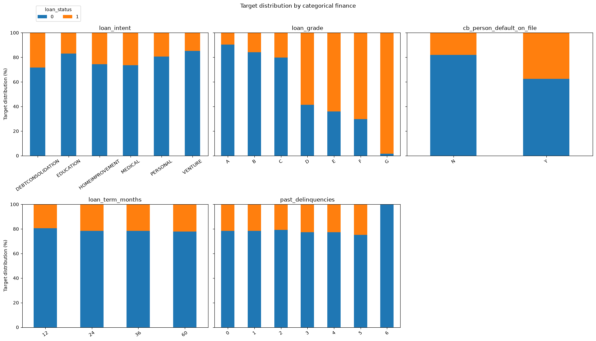
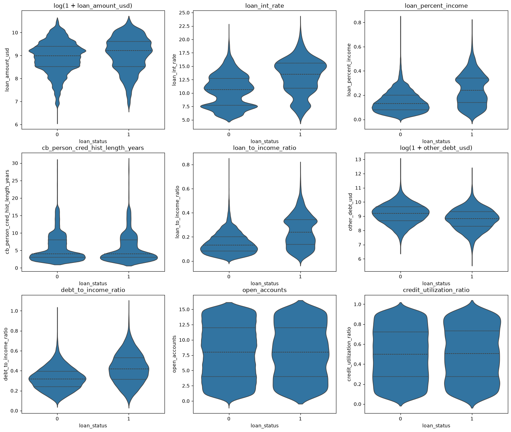

There are visible correlations with the target for most of financial features. Some typical relations:
- Better loan grade, lower default rate. There are sharp changes between C and D, and between F and G. 
- Borrowerd with previous default history are more likely to default
- Higher interest rate more likely leads to default.
- Borrowers with other debts are less likely to default.
- Higher loan to income or debt to income ratio, more likely to default.

### **Correlation heatmap**

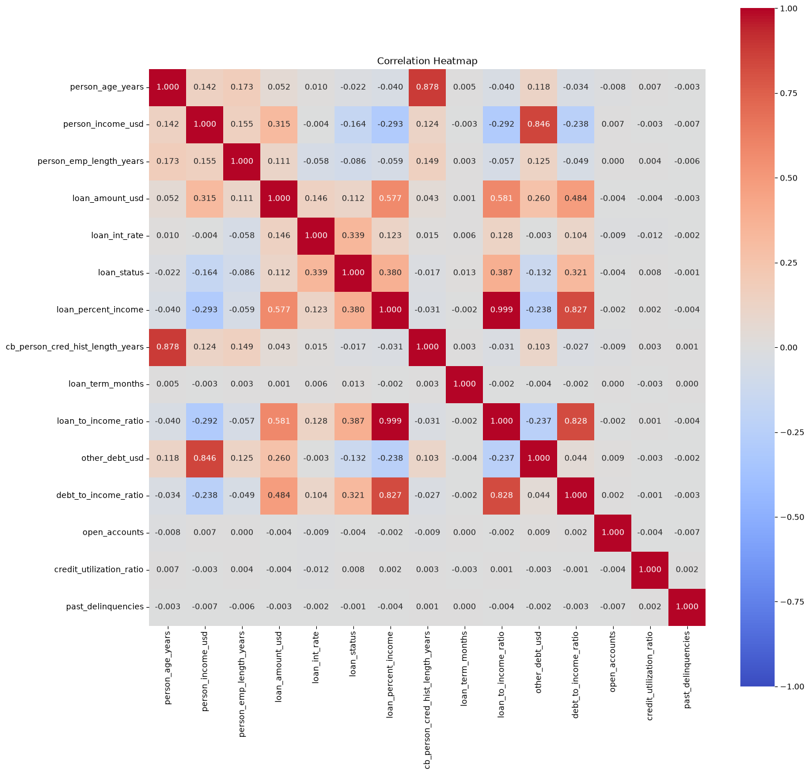

There is a noticable strong correlation (approx. 1.0) between `loan_percent_income` and `loan_to_income_ratio`. A follow-up analysis showed that one should keep only 1 of these two (say, `loan_to_income_ratio`) and the their ratio to avoid multicollinearity. This is important for logistic regression. For tree-based models, such multicollinearity is not harmful.

There is also a strong linear correlation between `debt_to_income_ratio` and `loan_to_income_ratio`, and between `log1p(other_debt_usd)` and `log1p(person_income_usd)` (linear bands). It turns out that introducing `other_debt_to_income_ratio = debt_to_income_ratio - loan_to_income_ratio`, or just `other_debt_usd/person_income_usd` and removing `other_debt_usd` is a solution for such collinearities.

Based on the data behavior, we also create some new features. These take into account some nonlinear interactions and would be useful for linear model. They include:
- high_lti: is loan_to_income_ratio > 0.3?
- loan_grade_sep: separation between ABC and DEFG load grade groups.
- high_income: is the income high (log1p(income)>9.9)?
- high_lti_x_rent: high_lti multiply by (is rent?) -> high lti + rent is more risky.

Also, log-transform features are created: log_loan_amount_usd and log_person_income_usd.

##  4. Classification machines

### **Train and test sets**: 
Train-test stratified split, with test size is 0.2

### **Preprocessing pipeline**

* Categorical Encoding:
    - Ordinal Encoding: `loan_grade`
    - OHE for other categorical features
* Missing values imputation: kNN imputation
* Standard scaling for numerical features (for logistic regression and when using kNN with distance weights)

###  **4.1 Baseline models: DummyClassifier and Shallow Decision Tree** 

**Why baseline?** A easy-to-build and informative reference point to test the performance of a more complex model. 

**DummyClassifier**. This is a minimum floor for every classifier. It provides zero-learning result; so if a model really learns something properly from the input, even a bit, it should have a better performance.

The performances of three Dummy Classifiers on the test set are reported below

| Strategy | Accuracy | Balanced accurracy (macro-avg recall) | F1 (default/minority) | F1 macro | ROC-AUC | PR-AUC (avg. precision) |
|-|-|-|-|-|-|-| 
|most-frequent| 0.782 | 0.500 | 0.000 | 0.439 |0.500|0.218|
|stratified (seed=42)| 0.665 | 0.508 | 0.230 | 0.508 | 0.508 | 0.221 |  
|constant (constant=1)| 0.218 | 0.500| 0.358| 0.179| 0.500| 0.218|

Except for `Accuracy`, we should expect higher values for other merics in the above table for a model truly learning something.

**Shallow Tree.** We go to a bit more complex model for the baseline: DecisionTree with fixed hyperparameters: shallow tree's `max_depth=5`, `min_samples_leaf=20`, `random_state=42`, `class_weight="balanced"`, and others are default. We don't keep `max_depth=None, min_samples_leaf=1` to avoid overfitting (memorize rather than generalise). DecisionTree has built-in support for nulls by settting the hyperparameter `splitter='best'` by default. However, here we consider both treatments for nulls: leave them as is, and impute using kNN. Consequently, there are two pipelines. The kNN imputer uses the default k value (`n_neighbors = 5`), weights by (inverse) distance, and adds a null indicator.  

The two pipelines together with their performances are shown below. In turns out that the obtained metrics for two pipelines are quite similar, and the pipeline without kNN imputer behave a bit better. Gain in the tables is measured against the strongest of three trivial classifiers (most frequent (always non-default), stratified random, always default) for each metric. DT baselines are substantially and clearly above every no-skill reference (the 95% CI PR-AUC excludes the floor)

- With kNN imputer:

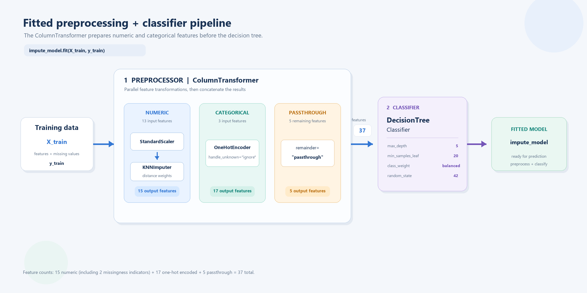
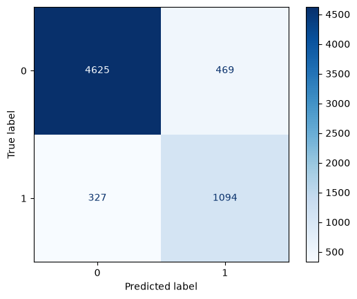

| Metric | Test | Dummy (all) | Gain (Test-Dummy)| Train |
|-|-|-|-|-|
|PR-AUC (avg. precision) | 0.802 [0.785, 0.820] (95% CI) | 0.218 | +0.584 | 0.817 |
|ROC-AUC | 0.880 | 0.500 | +0.380 | 0.895 |
|Balanced accuracy (macro-avg recall) | 0.841 | 0.500 | +0.341 | 0.851 |
|F1 (default) | 0.744 | 0.358 | + 0.386 | 0.750 |
|F1 (macro) | 0.830 | 0.495 | +0.335 | 0.838 |
|Accuracy | 0.881 | 0.782 | +0.099 | 0.885 |

- Without kNN imputer:

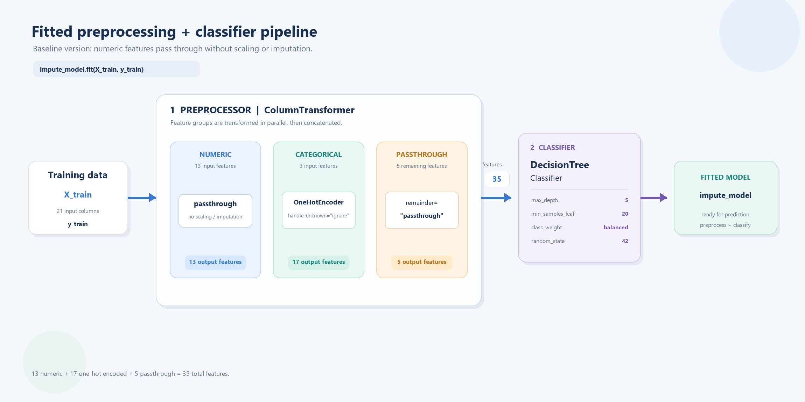 
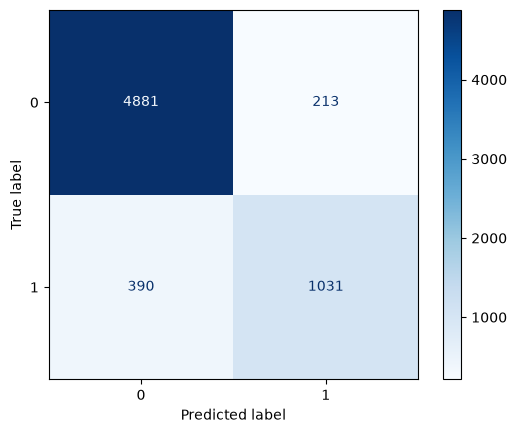

| Metric | Test | Dummy (all) | Gain (Test-Dummy)| Train |
|-|-|-|-|-|
|PR-AUC (avg. precision) | 0.815 [0.797, 0.831] (95% CI) | 0.218 | +0.597 | 0.831 |
|ROC-AUC | 0.880 | 0.500 | +0.380 | 0.895 |
|Balanced accuracy (macro-avg recall) | 0.842 | 0.500 | +0.342 | 0.849 |
|F1 (default) | 0.774 | 0.358 | + 0.416 | 0.784 |
|F1 (macro) | 0.858 | 0.495 | +0.363 | 0.864 |
|Accuracy | 0.907 | 0.782 | +0.125 | 0.911 |

PR-AUC is about 3.7x the prevalence (0.218), and default-class F1 is roughly double the always-default floor (0.733 vs 0.358). The model with kNN (without kNN) predicts the defaults (1) with **77% (72.6%) recall** and **70.8% (82.9%) precision**. The train and test scores also differ by only about 0.01, so the result is not an overfitting artifact. Overall, this is a strong baseline. Tree structure for the no-kNN pipeline is shown below

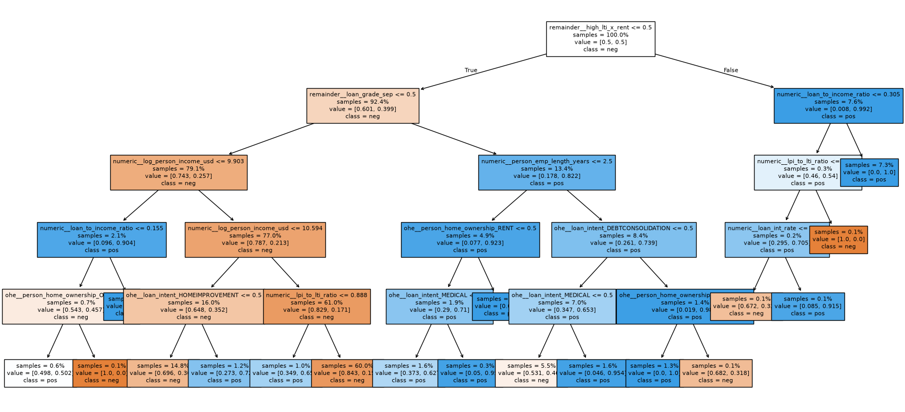

**Feature Importance**: In both pipelines, the three most important features are the same: loan_grade_sep, high_lti_x_rent, and person_income_usd. Their scores are significantly higher than remainders. The following plots show the feature importance of top 12 features. 

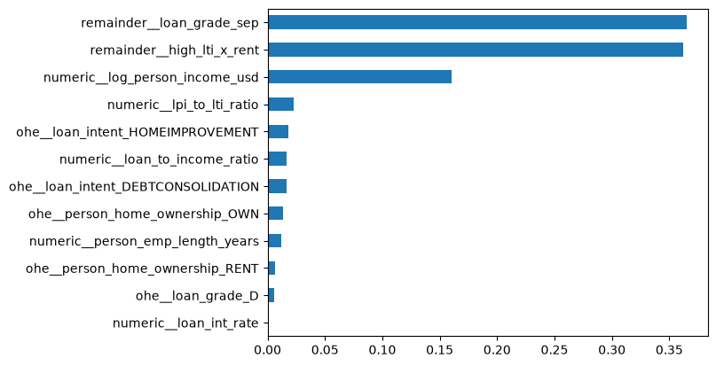
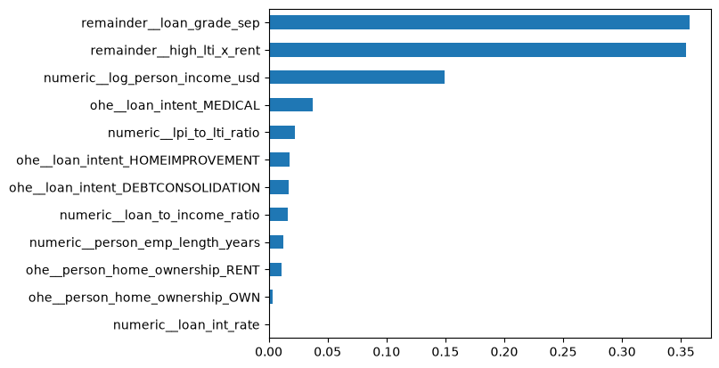

###  **4.2 Tuning Logistic Regression** 

We use optuna study and cross validation for hyperparameter tuning. Following hyperparams are tuned:
- `scaler`: [StandardScaler(), RobustScaler()]
- `n_neighbors` and `weights` of kNN imputer
- `C`, `solver`, `l1_ratio`, and `class_weight` of LogisticRegression

The choice of optimization metric depends on the business goal. Here, **we assume that both false positive (losing good customers) and false negative (taking on credit risk) are equally costly. Because both errors cannot be ignored, we need a score that balances both. F1 score is what we want.** 

Since F1 depends on the decision threshold, the threshold is tuned jointly with the pipeline hyperparams instead of being fixed at 0.5. Keeping the 0.5 threshold would be not a good idea, as our data is (mildly) imbalanced. 

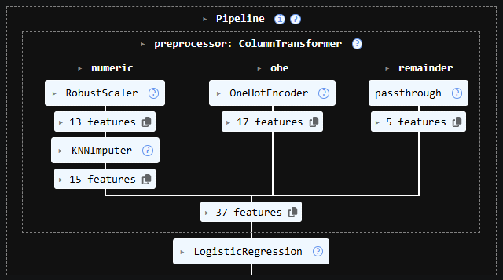 
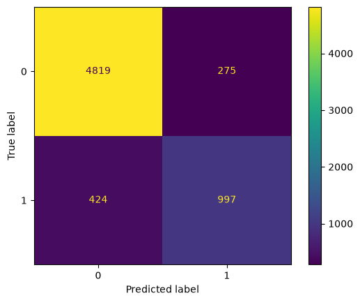

| Metric | Test | DT (with kNN)  | Gain (Logit-DT)| Train |
|-|-|-|-|-|
|PR-AUC (avg. precision)| 0.816 | 0.802 | +0.014 | 0.830  |
|ROC-AUC| 0.904 | 0.880 | +0.024 | 0.913 |
|Balanced accuracy (macro-avg recall)| 0.824  | 0.841 | -0.017 | 0.835|
|Recall (default)| 0.702 |0.770 | -0.068 | 0.725 |
|Precision (default)| 0.784 | 0.708 | +0.076 | 0.783 |
|Precision (macro)| 0.851 | 0.821 | +0.030 | 0.854 |
|F1 (default)| 0.740 | 0.738 | +0.002 | 0.753 |
|F1 (macro)| 0.836 | 0.830 | +0.006 | 0.844 |
|Accuracy| 0.893 | 0.881 | +0.012 | 0.896 |

The best CV parameters for threshold and class imbalance are 0.400 and 1.148, respectively.

From above table we can see that, the tuned Logit Classifier performs slightly better than the Shallow Tree baseline. The recall is sacrified to gain better precision. In particular, the precision on default is improved by 7.6%. This is the trade-off. 

